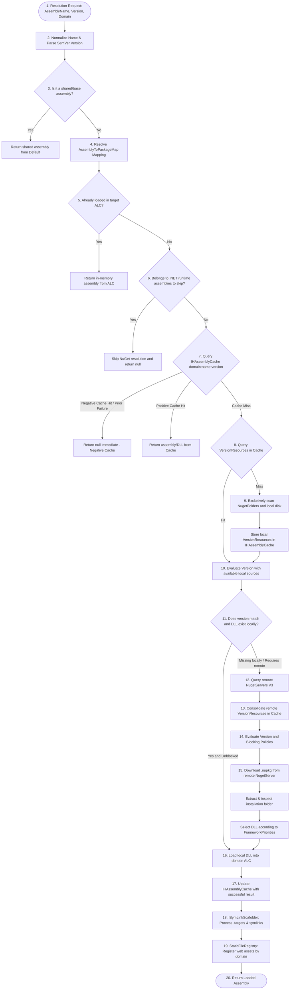

### Architecture of the HorizonteNet Modular Management System

The **HorizonteNet** modular environment provides an extensible framework built on .NET 10 for dynamic loading, isolation, dependency resolution, and decoupled execution of modules, commands, and background services.

This document describes the technical architecture of the system, specifying the distribution of responsibilities, contracts of its core components, configuration models, and operational flows for resolution and lifecycle management.

---

### Architecture Overview

The core of the modular system is organized around a central orchestrator (`IEnvCoordinator`) that governs four specialized subsystems and their supporting services:

1. **Assemblies and Resources (`IHAssemblySolver`)**: Dependency resolution, NuGet package downloading, unified assembly cache management (`IHAssemblyCache`), target framework version selection (`IPackageSolver`), symbolic link scaffolding derived from `.targets` and `.props` files (`ISymLinkScafolder`), and in-memory registration of web static assets by domain (`StaticFileRegistry`).
2. **Domains and Isolation (`IHDomainManager`)**: Lifecycle management of assembly load contexts (`AssemblyLoadContext`), creation and unloading of collectible logical domains (*Collectible ALC*), memory isolation, and Hot Reload support.
3. **Modules and Commands (`IHGesCom`)**: Dynamic discovery of modules decorated with `[HorizonteModule]`, registration and synchronous, asynchronous, and JSON-based invocation of role-based commands (`HCommand`).
4. **Background Services (`IhWorkersManager`)**: Lifecycle control, supervision, startup, and shutdown of background tasks and workers (`WorkerDefItem`).

#### System Flow and Integration Overview

```
+----------------------------------------------------------------------------------------------------+
|                               CONSUMERS AND APPLICATION SERVICES LAYER                             |
|                                                                                                    |
|  +--------------------+  +----------------------+  +---------------------+  +-------------------+  |
|  | Blazor UI / Panel  |  | ASP.NET Middleware   |  | Services / Workers  |  | Scripts / Editor  |  |
|  | (AdminUi, Grids,   |  | (HorizonteStaticFile |  | (BackgroundServices,|  | (Monaco,          |  |
|  |  AssembliesViewer) |  |  Middleware)         |  |  WebWorker)         |  |  Completions)     |  |
|  +---------+----------+  +----------+-----------+  +----------+----------+  +---------+---------+  |
+------------|------------------------|-------------------------|-----------------------|------------+
             |                        |                         |                       |
             | (Load/Unload/Reload,   | (StaticFileRegistry     | (Start/StopWorker,    | (Assemblies,
             |  DomainChanged)        |  GetFile by Domain)     |  BackgroundRunning)   |  CreateInstance)
             v                        v                         v                       v
+----------------------------------------------------------------------------------------------------+
|                                         IEnvCoordinator                                            |
|                                      (Central Coordinator)                                         |
|  - Unified facade and main entry point for the modular environment                                 |
|  - Lifecycle orchestration: LoadDomainAsync, UnloadDomainAsync, ReloadDomainAsync                  |
|  - Change notifications via DomainChanged event                                                    |
|  - Consolidated state exposure: Assemblies, AssembliesByDomain, StaticFileRegistry                 |
|  - Delegation of invocations to 4 specialized subsystems                                           |
+----------------------------------------------------------------------------------------------------+
       |                                |                             |                        |
       v                                v                             v                        v
+---------------+               +---------------+             +---------------+        +---------------+
|IHAssemblySolve|               |IHDomainManager|             |    IHGesCom   |        |IhWorkersManage|
| (Assemblies & |               |  (Domains &   |             |  (Modules &   |        |  (Services &  |
|   Resources)  |               |     ALC)      |             |   Commands)   |        |   Workers)    |
+-------+-------+               +---------------+             +---------------+        +---------------+
        |                                                                                      |
        +-------------------+--------------------+--------------------+                        | (Manages)
        |                   |                    |                    |                        v
        v                   v                    v                    v                +---------------+
+---------------+   +---------------+    +---------------+    +---------------+        | Background    |
|IHAssemblyCache|   | IPackageSolver|    |ISymLinkScafold|    |StaticFileRegis|        | Services      |
| (Resol. Cache)|   | (NuGet Resol.)|    |(Links .targets|    | (Web Mapping  |        +---------------+
+---------------+   +---------------+    | to proc dir)  |    |  by Domain)   |
                                         +---------------+    +-------+-------+
                                                                      |
                                                                      +---> [Queried by Web
                                                                             Middleware]
```

---

### Main Components and Responsibilities

#### 1. `IEnvCoordinator` (Central Coordinator and Environment Facade)

`IEnvCoordinator` constitutes the entry point and primary facade for consumers of the modular system (Blazor UI layer, ASP.NET Core web middleware, background services, and script editors).

- **Responsibilities**:
  - Expose direct access to the four specialized subsystems: `AssemblySolver`, `DomainManager`, `GesCom`, and `WorkersManager`.
  - Orchestrate the lifecycle of modular domains (`LoadDomainAsync`, `UnloadDomainAsync`, `ReloadDomainAsync`), coordinating the shutdown of workers, command unregistration, ALC context unloading, and assembly reloading.
  - Publish the `DomainChanged` event upon any alteration in active domains or assemblies.
  - Provide consolidated runtime views: global assembly list (`Assemblies`), domain grouping (`AssembliesByDomain`), and static file registry (`StaticFileRegistry`).
  - Offer delegated operations for background service control (`StartBackgroundService`, `StopBackgroundService`, `BackgroundServiceRunning`) and per-domain commands (`LoadModule`, `UnloadModule`, `LoadCommandsByDomain`, `UnloadCommandsByDomain`).
  - Provide explicit preloading and registration of native / unmanaged libraries from custom file paths (`LoadUnmanagedDll`).
  - Resolve type instantiation via the dependency injection container (`CreateInstance`).

- **Operational Contract of `IEnvCoordinator`**:
  - `AssemblySolver`: Read-only property of type `IHAssemblySolver`.
  - `DomainManager`: Read-only property of type `IHDomainManager`.
  - `GesCom`: Read-only property of type `IHGesCom`.
  - `WorkersManager`: Read-only property of type `IhWorkersManager`.
  - `Assemblies`: Read-only property of type `IReadOnlyList<Assembly>`.
  - `AssembliesByDomain`: Read-only property of type `IReadOnlyDictionary<string, List<Assembly>>`.
  - `StaticFileRegistry`: Read-only property of type `StaticFileRegistry`.
  - `DomainChanged`: Event of type `Action?`.
  - `LoadDomainAsync(string domainName)`: Loads a modular domain from its registered configuration.
  - `LoadDomainAsync(string domainName, IEnumerable<byte[]> assemblies)`: Loads a modular domain from in-memory binary assembly sequences.
  - `UnloadDomainAsync(string domainName)`: Unloads domain and frees associated resources.
  - `ReloadDomainAsync(string domainName)`: Reloads domain, refreshing its assemblies and services.
  - `StartBackgroundService(string serviceType)` / `StopBackgroundService(string serviceType)`: Execution control for workers.
  - `BackgroundServiceRunning(string serviceType)`: Checks worker execution state.
  - `LoadModule(string domainName)` / `UnloadModule(string domainName)`: Module registration/unregistration per domain.
  - `LoadCommandsByDomain(string domainName)` / `UnloadCommandsByDomain(string domainName)`: Command loading and unloading per domain.
  - `LoadUnmanagedDll(string? domainName, string unmanagedDllName, string libraryPath)`: Explicitly loads a native library (.so, .dll, .dylib) into a domain and registers it for P/Invoke resolution.
  - `CreateInstance(Type type)`: Type instantiation with dependency injection.

---

#### 2. `IHAssemblySolver` (Assemblies and Resources Manager)

`IHAssemblySolver` centralizes library (.dll) resolution, NuGet package downloading, unified cache administration, symbolic link scaffolding for native resources, and web static asset management.

- **Responsibilities**:
  - Resolve assemblies requested by specific context load events (`ResolveAssemblyFromALC`) and global events (`ResolveAssemblyFromNuGetPackages`).
  - Resolve and load native / unmanaged libraries (.so, .dll, .dylib) requested in P/Invoke calls (`ResolveUnmanagedDll`) by probing compatible RIDs in `./runtimes/{rid}/native/`, `AppContext.BaseDirectory`, and package folders.
  - Register and store handles of manually preloaded native libraries per domain (`RegisterUnmanagedDll`).
  - Locate physical library paths on disk (`ResolveAssemblyDllPath`) and download packages from remote feeds (`DownloadNuGetPackageAsync`).
  - Maintain bidirectional mapping between assembly names and NuGet package IDs (`GetPackageName`, using `AssemblyToPackageMap`).
  - Store and query in-memory assembly bytes (`CacheAssembly`, `GetCachedAssembly`, `IsAssemblyCached`).
  - Manage web static asset catalog per domain (`StaticFileRegistry`) for web middleware.
  - Delegate structured cache management to `IHAssemblyCache` and package evaluation to `IPackageSolver`.

- **Auxiliary Resolution Components**:

  1. **`IHAssemblyCache` (Unified In-Memory Cache)**:
     - Stores assembly resolution items (`AssemblyCacheItem`), indexed by name, version, and domain.
     - Maintains unified catalog of discovered package versions and origins (`VersionResources`).
     - Supports negative caching: records failed lookups (null `DllPath` or `ResolvedAssembly`) to prevent redundant disk/network queries.
     - Allows global invalidation (`Clear()`) or domain-specific invalidation (`Clear(domainName)`).

  2. **`IPackageSolver` (NuGet Package Evaluator and Selector)**:
     - Evaluates and selects optimal version and DLL file (`ResolvePackageAsync`, returning `PackageResolutionResult`).
     - Locates DLLs in local folders and repositories (`NugetFolders`, user cache `~/.nuget/packages`) via `ResolveLocalDllPath`.
     - Downloads and installs packages from remote servers (`NugetServers`) via `DownloadAndInstallPackageAsync`.
     - Applies framework priorities (`FrameworkPriorities`) and validates blocked package policies (`BlockedPackagesPolicy`: `Null`, `Error`, `Mayor`).

  3. **`ISymLinkScafolder` (Symbolic Link Scaffolder)**:
     - Inspects `.targets` and `.props` files from NuGet packages (`build/` and `buildTransitive/`).
     - Recreates `CopyToOutputDirectory` behavior by generating symbolic links in the process working directory.
     - Protects system against collisions: if target file/link exists, does not overwrite and emits a warning.
     - Provides build (`BuildScafolder`), query (`GetScafolder`), and cleanup (`CleanScafolder`) operations.

- **Cache Item Structure (`AssemblyCacheItem`)**:
  - `AssemblyName` (`string`): Requested assembly name.
  - `Version` (`string`): Assembly version.
  - `DomainName` (`string`): Associated execution domain (defaults to `"Default"`).
  - `PackageId` (`string?`): Associated NuGet package ID.
  - `PackageVersion` (`string?`): Resolved package version.
  - `DllPath` (`string?`): Absolute physical path to DLL file.
  - `ResolvedAssembly` (`Assembly?`): In-memory loaded assembly instance.
  - `IsResolved` (`bool`): Indicator that resolution process completed.
  - `Found` (`bool`): Indicator whether assembly was successfully found.
  - `VersionResources` (`VersionResources?`): Catalog of discovered versions and origins.
  - `ResolvedAtUtc` (`DateTime`): Resolution timestamp.

- **General Resolution Flow and Interaction**:

```
[ Resolution Request ] (ResolveAssemblyFromALC / ResolveAssemblyFromNuGetPackages / ResolveAssemblyDllPath)
                        [Parameters: AssemblyName, Version, Domain]
                                               |
                                               v
                             +-----------------------------------+
                             | 1. Normalization & Mapping        |
                             |  - AssemblyHelpers / Alias Map    |
                             +-----------------+-----------------+
                                               |
                                               v
                             +-----------------------------------+
                             | 2. Query IHAssemblyCache          |
                             |  - (AssemblyName, Version, Domain)|
                             +-----------------+-----------------+
                                               |
                          +--------------------+--------------------+
                          |                                         |
                  [Exists in Cache?]                                |
                          | YES                                     | NO
                          v                                         v
          +-------------------------------+         +----------------------------------+
          | 3. Cache Item Found           |         | 4. Invoke IPackageSolver         |
          |  - If Dll/Assembly != null    |         |  - Local NugetFolders scan       |
          |    -> Return Assembly         |         |  - Immediate local resolution    |
          |  - If Dll/Assembly == null    |         |  - Fallback: NugetServers (V3)   |
          |    -> Prior failure recorded  |         |  - Download / Extract nupkg      |
          |       (Return null immediate) |         |  - Select TFM by priority        |
          +-------------------------------+         +-----------------+----------------+
                                                                      |
                                                                      v
                                                    +----------------------------------+
                                                    | 5. Store in IHAssemblyCache      |
                                                    |  - Save AssemblyCacheItem        |
                                                    +-----------------+----------------+
                                                                      |
                                                                      v
                                                    +----------------------------------+
                                                    | 6. Resource Processing           |
                                                    |  - ISymLinkScafolder (.targets)  |
                                                    |  - StaticFileRegistry (by domain)|
                                                    |  - Load into ALC & Final Return  |
                                                    +----------------------------------+
```

---

#### 3. `IHDomainManager` (Domain and ALC Context Manager)

`IHDomainManager` directly manages .NET assembly load contexts (`AssemblyLoadContext`), ensuring memory isolation and logical domain lifecycle control.

- **Responsibilities**:
  - Maintain dictionary of active domains (`Domains`).
  - Create and configure collectible load contexts (`CreateDomain` with `isCollectible = true`).
  - Intercept and connect the `ResolvingUnmanagedDll` event on `AssemblyLoadContext.Default` and each custom ALC, delegating resolution to `IHAssemblySolver.ResolveUnmanagedDll`.
  - Load assemblies into specific domains from file paths or in-memory binary streams (`LoadDomainContextAsync`).
  - Unload contexts (`UnloadDomainContextAsync`), disconnecting references and event handlers (`Resolving`, `ResolvingUnmanagedDll`) and forcing garbage collection (`GC.Collect`) for effective memory reclamation.
  - Enumerate assemblies associated with a specific domain (`GetDomainAssemblies`).

---

#### 4. `IHGesCom` (Command and Module Manager)

`IHGesCom` administers module registration and execution of decoupled, role-based commands within the environment.

- **Responsibilities**:
  - Discover and instantiate classes decorated with `[HorizonteModule]` in loaded assemblies (`LoadModules`).
  - Execute initialization commands associated with the `"init"` role (`InitzializeModules`).
  - Register and query command definitions (`RegisterCommand`, `GetCommandList`, `GetHCommand`, `ExistCommand`, `IsAsyncCommand`).
  - Execute commands synchronously or asynchronously, with strongly-typed result support (`RunCommand<T>`, `RunCommandAsync<T>`).
  - Execute commands via JSON-serialized arguments and responses (`RunCommandJson`, `RunCommandJsonAsync`).
  - Manage lifecycle of commands associated with specific domains (`LoadCommandsByDomain`, `UnloadCommandsByDomain`).

---

#### 5. `IhWorkersManager` (Background Services Manager)

`IhWorkersManager` controls and supervises background services (*Workers*) configured in the system.

- **Responsibilities**:
  - Automatically start workers configured for system boot (`StartWorkers`).
  - Obtain catalog of available worker definitions (`GetAvailableWorkers`, returning `List<WorkerDefItem>`).
  - Individually start (`StartWorker`) and stop (`StopWorker`) services by name.
  - Query real-time execution status of each service (`WorkerIsRunning`).

---

### Interaction and Coordination Flows

#### Hot Reload Flow for a Domain

Controlled reloading of a modular domain via `IEnvCoordinator.ReloadDomainAsync` executes the following sequence:

```
[Client / AdminUI]
        |
        v
[IEnvCoordinator.ReloadDomainAsync]
        |
        +---> 1. Stop domain services and workers (IhWorkersManager / EnvCoordinator)
        |
        +---> 2. Unregister domain commands (IHGesCom.UnloadCommandsByDomain)
        |
        +---> 3. Unload ALC and free memory (IHDomainManager.UnloadDomainContextAsync)
        |
        +---> 4. Invalidate domain cache entries (IHAssemblyCache.Clear(domainName))
        |
        +---> 5. Create new ALC and load assemblies (IHDomainManager + IHAssemblySolver)
        |
        +---> 6. Scan and register new domain commands (IHGesCom.LoadCommandsByDomain)
        |
        +---> 7. Restart services associated with the domain (IhWorkersManager)
        |
        +---> 8. Fire DomainChanged event
```

---

### Responsibility Distribution Matrix

| Functionality / Area | IEnvCoordinator | IHAssemblySolver | IHDomainManager | IHGesCom | IhWorkersManager |
| :--- | :---: | :---: | :---: | :---: | :---: |
| **Global Orchestration** | **Primary** | - | - | - | - |
| **NuGet Cache & Download** | Delegated | **Primary** | - | - | - |
| **Web Static Files** | Delegated | **Primary** | - | - | - |
| **ALC Lifecycle** | Delegated | - | **Primary** | - | - |
| **Assembly Isolation** | Delegated | Query | **Primary** | - | - |
| **Command Registration** | Delegated | - | - | **Primary** | - |
| **Role/JSON Invocation** | Delegated | - | - | **Primary** | - |
| **Worker Lifecycle** | Delegated | - | - | - | **Primary** |
| **DI Instantiation** | **Primary** | - | - | - | - |

---

### Environment Configuration and Data Model (`ModulesSettings`)

The modular system is configured via the context provider (`IhContext`), which materializes options defined in JSON configuration files (such as `horizonte.json` or `horizonte.default.json`).

The core configuration section is `ModulesSettings`, containing the following elements:

#### Structure and Properties of `ModulesSettings`

1. **`List` (`List<ModulesSettingsItem>`)**:
   - Catalog of modules to initialize in the application.
   - Each item specifies: `ModuleName` (module name), `ModuleVersion` (module version), `Path` (optional local path), `LoadAdditionalDlls` (flag to load extra DLLs from directory), `Domain` (assigned domain), and `Active` (activation state).

2. **`NugetServers` (`List<NugetServerItem>`)**:
   - Prioritized list of NuGet servers and feeds (e.g., NuGet.org or private feeds).
   - Each item defines: `Server` (feed URL), `Name` (identifier name), `Order` (priority order), `Version` (API version, e.g., 3), and `Active` (activation state).

3. **`NugetFolders` (`List<NugetFolderItem>`)**:
   - Local directories used for resolving and storing installed packages.
   - Each item specifies: `Folder` (folder path), `Name` (identifier), `Order` (search order), `InstallFolder` (indicates installation destination), and `Active` (activation state).

4. **`UseUserNugetFolder` (`bool`)**:
   - Indicates whether to use the system user's global NuGet cache (`~/.nuget/packages`).

5. **`FrameworkPriorities` (`List<string>`)**:
   - Ordered list of Target Framework Monikers (TFMs) by resolution preference (e.g., `net10.0`, `net9.0`, `netstandard2.1`, `net8.0`).

6. **`ForcedPackages` (`List<ForcedPackageItem>`)**:
   - Collection of NuGet packages whose presence and loading is mandatory in the environment.
   - Each item specifies: `PackageId` (package identifier), `Version` (required version), `Framework` (compatible framework), `Domain` (load domain, defaults to `"Default"`), and `Active` (activation flag).

7. **`BlockedPackages` (`List<BlockedPackageItem>`)**:
   - List of packages or versions blocked due to incompatibility or security reasons.
   - Each item specifies: `PackageId` (blocked package identifier), `Version` (blocked version or pattern), `Reason` (block reason), and `Active` (rule activation flag).

8. **`BlockedPackagesPolicy` (`BlockedPackagesPolicy`)**:
   - Policy applied by the resolver when a requested package matches a `BlockedPackages` rule.
   - Available values:
     - `Null` (`BlockedPackagesPolicy.Null`): Cancels package resolution returning `null` without throwing an exception.
     - `Error` (`BlockedPackagesPolicy.Error`): Emits an error or halts resolution with a security exception.
     - `Mayor` (`BlockedPackagesPolicy.Mayor`): Finds and selects the closest higher available non-blocked version.

9. **`AssemblyToPackageMap` (`Dictionary<string, string>`)**:
   - Mapping dictionary between assembly file names and the NuGet package ID containing them, for cases where the DLL name differs from the package ID.

10. **`Domains` (`List<string>`)**:
    - Declarative list of logical domain names to initialize in the application.

#### JSON Configuration Example

```json
{
  "ModulesSettings": {
    "List": [
      {
        "Active": true,
        "ModuleName": "Horizonte",
        "ModuleVersion": "10.0.7-beta",
        "Path": "",
        "LoadAdditionalDlls": false,
        "Domain": "Default"
      }
    ],
    "NugetServers": [
      {
        "Server": "https://api.nuget.org/v3/index.json",
        "Name": "Nuget.org",
        "Order": 1,
        "Version": 3,
        "Active": true
      }
    ],
    "NugetFolders": [
      {
        "Folder": "packages",
        "Name": "Horizonte",
        "Order": 0,
        "InstallFolder": true,
        "Active": true
      }
    ],
    "UseUserNugetFolder": false,
    "FrameworkPriorities": [
      "net10.0",
      "netstandard2.1",
      "net8.0"
    ],
    "ForcedPackages": [
      {
        "Active": true,
        "PackageId": "Newtonsoft.Json",
        "Version": "13.0.3",
        "Framework": "net10.0",
        "Domain": "Default"
      }
    ],
    "BlockedPackages": [
      {
        "Active": true,
        "PackageId": "Vulnerable.Package.Sample",
        "Version": "1.0.0",
        "Reason": "Security vulnerability (CVE-XXXX)"
      }
    ],
    "BlockedPackagesPolicy": "Mayor",
    "AssemblyToPackageMap": {
      "Microsoft.CodeAnalysis": "Microsoft.CodeAnalysis.Common"
    },
    "Domains": [
      "Default"
    ]
  }
}
```

---

### Resolution, Loading, and Resource Management Processes

#### 1. Fundamental Rules of Assembly Runtime

The **HorizonteNet** isolation model is based on the following .NET premises:

1. **`"Default"` Domain (`AssemblyLoadContext.Default`)**:
   - Root non-collectible context hosting application host, .NET runtime, and shared base assemblies.
   - Assemblies in `"Default"` cannot be unloaded individually without restarting the process.

2. **Isolated Secondary Domains (Collectible ALCs)**:
   - Dynamically created with type and memory isolation.
   - Allow multiple versions of the same package to coexist in memory (multi-version isolation).
   - Collectible and can be unloaded individually via `IEnvCoordinator.UnloadDomainAsync`.

3. **Assembly Immutability per ALC**:
   - Within the same load context, once an assembly with a specific name (`AssemblyName`) is loaded, the runtime does not allow loading another version of that same assembly in that same context.

---

#### 2. Behavior in Multi-Version Scenarios

The system behavior when different versions of the same package are requested depends on the nature of their resources:

##### A. Web Assets (`StaticFileRegistry`)
`StaticFileRegistry` stores static files (`/_content/{package}/...`) in memory indexed under a composite domain and path key (`domain#path`).
- If `DomainA` requests `WebPackage 1.0.0` and `DomainB` requests `WebPackage 2.0.0`, both assets coexist in memory in an isolated manner.
- The `HorizonteStaticFileMiddleware` resolves the appropriate file based on the request domain without disk collisions.

##### B. Symbolic Links and Native Resources (`ISymLinkScafolder`)
`ISymLinkScafolder` processes `.targets` and `.props` files to create symbolic links in the process working directory.
- If `DomainA` loads `NativePackage 1.0.0`, symbolic links are created in the working directory.
- If `DomainB` subsequently loads `NativePackage 2.0.0`, scaffolding detects that destination files already exist and **does not overwrite existing links**, emitting a warning.
- **Architectural Rule**: Packages depending on native binaries or `.targets` files should be unified in the `"Default"` domain or registered in `ForcedPackages` to guarantee a single consistent version across the process.

---

#### 3. Resolution Engine with NuGet SDK and Unified Cache

Package and dependency resolution uses official NuGet SDK components (`NuGet.Protocol`, `NuGet.Versioning`), coordinated with the in-memory cache `IHAssemblyCache`.



#### Resolution Process Phases

1. **Resolution Request**: Received from `AssemblyLoadContext.Resolving` or direct call to `ResolveAssemblyFromNuGetPackages`.
2. **SemVer Normalization**: Parsing of name and version using `AssemblyHelpers.ParseAssemblyName` and `NuGetVersion.TryParse`.
3. **Shared Assembly Evaluation**: Verification if the assembly belongs to the shared base libraries in `"Default"`.
4. **Alias Resolution (`AssemblyToPackageMap`)**: Conversion of assembly name to the corresponding NuGet package ID.
5. **ALC Inspection**: Immediate reuse if assembly is already loaded in target context.
6. **Runtime Filter**: Exclusion of base .NET runtime assemblies that should not be resolved via NuGet.
7. **Query `IHAssemblyCache`**: Lookup by domain, assembly, and version key. Returns positive hit if cached, or immediate `null` on negative cache.
8. **Query `VersionResources`**: Checks if version catalog is already present in in-memory cache.
9. **Prioritized Local Scan**: On cache miss, `IPackageSolver` initially scans local folders (`NugetFolders`, `~/.nuget/packages`) exclusively and stores discovered versions in `VersionResources`.
10. **Immediate Local Evaluation and Resolution**: Evaluation of best matching version and validation against `BlockedPackages`. If version matches and physical DLL exists on disk, it is resolved immediately skipping any remote NuGet server calls.
11. **On-Demand Remote Probing**: If the requested package or version is missing locally (or if `BlockedPackagesPolicy.Mayor` requires a higher version not available locally), `IPackageSolver` queries remote NuGet servers (`NugetServers`) via `FindPackageByIdResource`.
12. **Cache Consolidation**: Incremental merging of newly discovered remote sources and versions into the `VersionResources` instance stored in `IHAssemblyCache`.
13. **Block Policy Evaluation and Final Selection**: Re-evaluation of best discovered version and application of `BlockedPackagesPolicy` (`Null`, `Error`, `Mayor`).
14. **Remote Download**: Asynchronous download of `.nupkg` package from active remote feed if needed.
15. **Extraction**: Unpacking package into configured installation folder.
16. **Target Framework Selection**: Selection of optimal `lib/` folder according to `FrameworkPriorities` order.
17. **Context Loading**: Loading DLL file into domain `AssemblyLoadContext`.
18. **Cache Update**: Recording successful result in `IHAssemblyCache`.
19. **Symbolic Link Scaffolding**: Unified processing of native assets (`/runtimes/{rid}/native/`) and MSBuild `.targets` / `.props` files via `ISymLinkScafolder` (both during dynamic resolution and initial forced package loading `ForcedPackages` via `ResolveAssemblyDllPath`).
20. **Web Asset Registration**: Adding static files to `StaticFileRegistry` under domain namespace.

---

#### 4. Resilience, Timeouts, and Concurrency

The `IPackageSolver` subsystem incorporates control mechanisms to ensure stability and prevent resolution deadlocks:

- **Server URL Normalization**: Automatic correction of NuGet feed endpoints towards standard V3 specifications (`index.json`).
- **Controlled Timeouts**: Strict linked `CancellationTokenSource` time limits per remote server (8 seconds for version queries and 20 seconds for package downloads).
- **Concurrent Queries**: Parallel querying via `Task.WhenAll` to all active remote servers configured in `NugetServers`.
- **Structured Traceability**: Emission of structured log traces with standard prefixes (`[PKGSOLVER-*]`, `[RESOLVER-*]`) for runtime auditing and diagnostics.

---

#### 5. Dynamic Resolution and Loading of Native Libraries (P/Invoke)

When a managed assembly invokes unmanaged native code via P/Invoke (e.g., `OpenCvSharp`, `SkiaSharp`, `TensorFlow`), the CLR raises the `AssemblyLoadContext.ResolvingUnmanagedDll` event.

- **Centralized Handler**: `HDomainManager` hooks `ResolvingUnmanagedDll` on `AssemblyLoadContext.Default` and all dynamically created ALC contexts, delegating resolution to `IHAssemblySolver.ResolveUnmanagedDll(context, unmanagedDllName)`.
- **Cross-Platform Probing Strategy**:
  1. **Explicit Preload / Registration**: Initial check for native libraries manually preloaded and registered via `IEnvCoordinator.LoadUnmanagedDll` or `IHAssemblySolver.RegisterUnmanagedDll` in the target domain or global `"Default"` domain.
  2. **Candidate Name Generation**:
     - **Linux / Unix**: `lib{Name}.so`, `{Name}.so`, `lib{Name}`, `{Name}`.
     - **Windows**: `{Name}.dll`, `{Name}`.
     - **macOS**: `lib{Name}.dylib`, `{Name}.dylib`, `lib{Name}`, `{Name}`.
  3. **Compatible RIDs**: Detection of the Runtime Identifier hierarchy via `NugetHelpers.GetCompatibleRuntimeIdentifiers` (e.g., `linux-x64` -> `linux` -> `unix` -> `any`).
  4. **Sequentially Probed Paths**:
     - `./runtimes/{cRid}/native/{candidateName}` (process working directory / scaffolding).
     - `<AppContext.BaseDirectory>/runtimes/{cRid}/native/{candidateName}`.
     - Local package directories registered in `NugetFolders`.
  5. **Safe In-Memory Loading**: Native binary loading via `NativeLibrary.TryLoad` returning the `IntPtr` handle pointer to the CLR, enabling transitive dependency resolution within the same directory.

##### Explicit Preload of Native Binaries (`LoadUnmanagedDll`)
For packages or custom binary distributions outside the `/runtimes/{rid}/native/` convention, `IEnvCoordinator` exposes a programmatic method:
```csharp
IntPtr LoadUnmanagedDll(string? domainName, string unmanagedDllName, string libraryPath);
```
This method validates the binary file path (`.so`, `.dll`, `.dylib`), loads it into memory with `NativeLibrary.TryLoad`, and registers the alias mapping in `IHAssemblySolver` for the specified domain (or `Default`), ensuring immediate resolution for subsequent P/Invoke calls within that domain.
