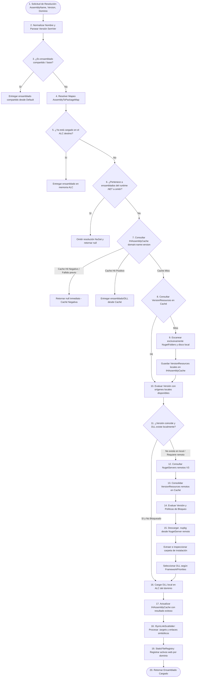

### Arquitectura del Sistema de Gestión Modular HorizonteNet

El entorno modular **HorizonteNet** proporciona un marco de trabajo extensible sobre .NET 10 para la carga dinámica, aislamiento, resolución de dependencias y ejecución desacoplada de módulos, comandos y servicios en segundo plano.

Este documento describe la arquitectura técnica del sistema, especificando la distribución de responsabilidades, los contratos de sus componentes principales, los modelos de configuración y los flujos operativos de resolución y ciclo de vida.

---

### Visión General de la Arquitectura

El núcleo del sistema modular se organiza alrededor de un orquestador central (`IEnvCoordinator`) que gobierna cuatro subsistemas especializados y sus servicios auxiliares:

1. **Ensamblados y Recursos (`IHAssemblySolver`)**: Resolución de dependencias, descarga de paquetes NuGet, gestión de la caché unificada de ensamblados (`IHAssemblyCache`), selección de versiones según frameworks de destino (`IPackageSolver`), andamiaje de enlaces simbólicos derivados de archivos `.targets` y `.props` (`ISymLinkScafolder`) y registro en memoria de activos estáticos web por dominio (`StaticFileRegistry`).
2. **Dominios y Aislamiento (`IHDomainManager`)**: Gestión del ciclo de vida de los contextos de carga de ensamblados (`AssemblyLoadContext`), creación y liberación de dominios lógicos coleccionables (*Collectible ALC*), aislamiento de memoria y soporte de recarga en caliente (*Hot Reload*).
3. **Módulos y Comandos (`IHGesCom`)**: Descubrimiento dinámico de módulos decorados con `[HorizonteModule]`, registro e invocación síncrona, asíncrona y mediante JSON de comandos basados en roles (`HCommand`).
4. **Servicios en Segundo Plano (`IhWorkersManager`)**: Control del ciclo de vida, supervisión, arranque y detención de tareas y trabajadores (*Workers*) en segundo plano (`WorkerDefItem`).

#### Esquema General de Integración y Flujo del Sistema

```
+----------------------------------------------------------------------------------------------------+
|                         CAPA DE CONSUMIDORES Y SERVICIOS DE APLICACIÓN                             |
|                                                                                                    |
|  +--------------------+  +----------------------+  +---------------------+  +-------------------+  |
|  | Interfaz Blazor/UI |  | Middleware ASP.NET   |  | Servicios / Workers |  | Scripts / Editor  |  |
|  | (AdminUi, Grids,   |  | (HorizonteStaticFile |  | (BackgroundServices,|  | (Monaco,          |  |
|  |  AssembliesViewer) |  |  Middleware)         |  |  WebWorker)         |  |  Completions)     |  |
|  +---------+----------+  +----------+-----------+  +----------+----------+  +---------+---------+  |
+------------|------------------------|-------------------------|-----------------------|------------+
             |                        |                         |                       |
             | (Load/Unload/Reload,   | (StaticFileRegistry     | (Start/StopWorker,    | (Assemblies,
             |  DomainChanged)        |  GetFile por Dominio)   |  BackgroundRunning)   |  CreateInstance)
             v                        v                         v                       v
+----------------------------------------------------------------------------------------------------+
|                                         IEnvCoordinator                                            |
|                                      (Coordinador Central)                                         |
|  - Fachada unificada y punto de entrada principal del entorno modular                              |
|  - Orquestación de ciclo de vida: LoadDomainAsync, UnloadDomainAsync, ReloadDomainAsync            |
|  - Notificación de cambios mediante el evento DomainChanged                                        |
|  - Exposición de estado consolidado: Assemblies, AssembliesByDomain, StaticFileRegistry             |
|  - Delegación de invocaciones a los 4 subsistemas especializados                                   |
+----------------------------------------------------------------------------------------------------+
       |                                |                             |                        |
       v                                v                             v                        v
+---------------+               +---------------+             +---------------+        +---------------+
|IHAssemblySolve|               |IHDomainManager|             |    IHGesCom   |        |IhWorkersManage|
| (Ensamblados  |               |  (Dominios &  |             |   (Módulos &  |        |  (Servicios & |
|   & Recursos) |               |     ALC)      |             |   Comandos)   |        |   Workers)    |
+-------+-------+               +---------------+             +---------------+        +---------------+
        |                                                                                      |
        +-------------------+--------------------+--------------------+                        | (Gestiona)
        |                   |                    |                    |                        v
        v                   v                    v                    v                +---------------+
+---------------+   +---------------+    +---------------+    +---------------+        | Background    |
|IHAssemblyCache|   | IPackageSolver|    |ISymLinkScafold|    |StaticFileRegis|        | Services      |
| (Caché Resol.)|   | (Resol. NuGet)|    |(Links .targets|    | (Mapeo Web    |        +---------------+
+---------------+   +---------------+    | a dir proceso)|    |  por Dominio) |
                                         +---------------+    +-------+-------+
                                                                      |
                                                                      +---> [Consultado por
                                                                             Middleware Web]
```

---

### Componentes Principales y Responsabilidades

#### 1. `IEnvCoordinator` (Coordinador Central y Fachada del Entorno)

`IEnvCoordinator` constituye el punto de entrada y la fachada principal para los consumidores del sistema modular (capa de presentación Blazor, middleware web de ASP.NET Core, servicios en segundo plano y editores de scripts).

- **Responsabilidades**:
  - Exponer el acceso directo a los cuatro subsistemas especializados: `AssemblySolver`, `DomainManager`, `GesCom` y `WorkersManager`.
  - Orquestar el ciclo de vida de los dominios modulares (`LoadDomainAsync`, `UnloadDomainAsync`, `ReloadDomainAsync`), coordinando la secuencia de parada de workers, desregistro de comandos, descarga de contextos ALC y recarga de ensamblados.
  - Publicar el evento `DomainChanged` ante cualquier alteración en el catálogo de dominios o ensamblados activos.
  - Proporcionar vistas consolidadas del estado en ejecución: lista global de ensamblados (`Assemblies`), agrupación por dominio (`AssembliesByDomain`) y el registro de archivos estáticos (`StaticFileRegistry`).
  - Ofrecer operaciones delegadas para el control de servicios en segundo plano (`StartBackgroundService`, `StopBackgroundService`, `BackgroundServiceRunning`) y comandos por dominio (`LoadModule`, `UnloadModule`, `LoadCommandsByDomain`, `UnloadCommandsByDomain`).
  - Proporcionar la precarga y registro explícito de librerías nativas / no administradas en rutas personalizadas (`LoadUnmanagedDll`).
  - Resolver la instanciación de tipos mediante el contenedor de inyección de dependencias (`CreateInstance`).

- **Contrato Operativo de `IEnvCoordinator`**:
  - `AssemblySolver`: Propiedad de solo lectura de tipo `IHAssemblySolver`.
  - `DomainManager`: Propiedad de solo lectura de tipo `IHDomainManager`.
  - `GesCom`: Propiedad de solo lectura de tipo `IHGesCom`.
  - `WorkersManager`: Propiedad de solo lectura de tipo `IhWorkersManager`.
  - `Assemblies`: Propiedad de solo lectura de tipo `IReadOnlyList<Assembly>`.
  - `AssembliesByDomain`: Propiedad de solo lectura de tipo `IReadOnlyDictionary<string, List<Assembly>>`.
  - `StaticFileRegistry`: Propiedad de solo lectura de tipo `StaticFileRegistry`.
  - `DomainChanged`: Evento de tipo `Action?`.
  - `LoadDomainAsync(string domainName)`: Carga un dominio modular a partir de su configuración registrada.
  - `LoadDomainAsync(string domainName, IEnumerable<byte[]> assemblies)`: Carga un dominio modular desde secuencias binarias de ensamblados en memoria.
  - `UnloadDomainAsync(string domainName)`: Descarga el dominio y libera sus recursos asociados.
  - `ReloadDomainAsync(string domainName)`: Recarga el dominio actualizando sus ensamblados y servicios.
  - `StartBackgroundService(string serviceType)` / `StopBackgroundService(string serviceType)`: Control de ejecución de workers.
  - `BackgroundServiceRunning(string serviceType)`: Consulta del estado de ejecución de un worker.
  - `LoadModule(string domainName)` / `UnloadModule(string domainName)`: Registro y desregistro de módulos por dominio.
  - `LoadCommandsByDomain(string domainName)` / `UnloadCommandsByDomain(string domainName)`: Carga y descarga de comandos por dominio.
  - `LoadUnmanagedDll(string? domainName, string unmanagedDllName, string libraryPath)`: Carga explícitamente una biblioteca nativa (.so, .dll, .dylib) en el dominio y la registra para resolución P/Invoke.
  - `CreateInstance(Type type)`: Instanciación de tipos con inyección de dependencias.

---

#### 2. `IHAssemblySolver` (Gestor de Ensamblados y Recursos)

`IHAssemblySolver` centraliza la resolución de librerías (.dll), descarga de paquetes NuGet, administración de la caché unificada de resolución, andamiaje de enlaces simbólicos para recursos nativos y gestión de archivos estáticos web.

- **Responsabilidades**:
  - Resolver ensamblados solicitados por eventos de carga de contextos específicos (`ResolveAssemblyFromALC`) y eventos globales (`ResolveAssemblyFromNuGetPackages`).
  - Resolver y cargar librerías nativas / no administradas (.so, .dll, .dylib) solicitadas en llamadas P/Invoke (`ResolveUnmanagedDll`) mediante sondeo de RIDs compatibles en `./runtimes/{rid}/native/`, `AppContext.BaseDirectory` y carpetas de paquetes.
  - Registrar y almacenar handles de librerías nativas precargadas manualmente por dominio (`RegisterUnmanagedDll`).
  - Localizar rutas físicas de librerías en disco (`ResolveAssemblyDllPath`, aceptando opcionalmente `targetFramework` prioritario) y descargar paquetes desde feeds remotos (`DownloadNuGetPackageAsync`).
  - Mantener el mapeo bidireccional entre nombres de ensamblados y nombres de paquetes NuGet (`GetPackageName`, utilizando `AssemblyToPackageMap` enriquecido dinámicamente mediante `[AssemblyMappingDefinition]`).
  - Registrar y actualizar mapeos en tiempo de ejecución (`RegisterAssemblyMapping`) y escanear ensamblados cargados en cualquier ALC (`ScanAssemblyForMappings`).
  - Almacenar y consultar bytes de ensamblados en memoria (`CacheAssembly`, `GetCachedAssembly`, `IsAssemblyCached`).
  - Administrar el catálogo de recursos web por dominio (`StaticFileRegistry`) para el middleware web.
  - Delegar la gestión de caché estructurada en `IHAssemblyCache` y la evaluación de paquetes en `IPackageSolver`.

- **Componentes Auxiliares de Resolución**:

  1. **`IHAssemblyCache` (Caché Unificada en Memoria)**:
     - Almacena elementos de resolución de ensamblados (`AssemblyCacheItem`), indexados por nombre, versión y dominio.
     - Mantiene el catálogo unificado de orígenes y versiones de paquetes descubiertos (`VersionResources`).
     - Soporta caché negativa: registra búsquedas fallidas (`DllPath` o `ResolvedAssembly` nulos) para evitar consultas redundantes a disco o red.
     - Permite la invalidación global (`Clear()`) o por dominio específico (`Clear(domainName)`).

  2. **`IPackageSolver` (Evaluador y Selector de Paquetes NuGet)**:
     - Evalúa y selecciona la versión y archivo DLL óptimos (`ResolvePackageAsync`, devolviendo `PackageResolutionResult` con soporte de `targetFramework` prioritario).
     - Localiza DLLs en repositorios y carpetas locales (`NugetFolders`, caché de usuario `~/.nuget/packages`) mediante `ResolveLocalDllPath` (con parámetro opcional `targetFramework`).
     - Descarga e instala paquetes desde servidores remotos (`NugetServers`) mediante `DownloadAndInstallPackageAsync`.
     - Aplica las prioridades de framework (`FrameworkPriorities`) y valida las políticas de paquetes bloqueados (`BlockedPackagesPolicy`: `Null`, `Error`, `Mayor`). Si se proporciona un `targetFramework`, se prioriza dicho TFM antes de recurrir a la lista de `FrameworkPriorities`.

  3. **`ISymLinkScafolder` (Andamiaje de Enlaces Simbólicos)**:
     - Inspecciona los archivos `.targets` y `.props` de los paquetes NuGet (`build/` y `buildTransitive/`).
     - Recrea el comportamiento de `CopyToOutputDirectory` generando enlaces simbólicos en el directorio de trabajo del proceso.
     - Protege el sistema frente a colisiones: si un enlace o archivo de destino ya existe, no lo sobrescribe y emite una advertencia.
     - Proporciona operaciones de construcción (`BuildScafolder`), consulta (`GetScafolder`) y limpieza (`CleanScafolder`).

- **Estructura del Registro de Caché (`AssemblyCacheItem`)**:
  - `AssemblyName` (`string`): Nombre del ensamblado solicitado.
  - `Version` (`string`): Versión del ensamblado.
  - `DomainName` (`string`): Dominio de ejecución asociado (por defecto `"Default"`).
  - `PackageId` (`string?`): Identificador del paquete NuGet asociado.
  - `PackageVersion` (`string?`): Versión concreta del paquete resuelto.
  - `DllPath` (`string?`): Ruta física absoluta al archivo DLL.
  - `ResolvedAssembly` (`Assembly?`): Instancia del ensamblado cargado en memoria.
  - `IsResolved` (`bool`): Indicador de que el proceso de resolución ha concluido.
  - `Found` (`bool`): Indicador de si el ensamblado fue hallado satisfactoriamente.
  - `VersionResources` (`VersionResources?`): Catálogo de versiones y orígenes descubiertos.
  - `ResolvedAtUtc` (`DateTime`): Marca temporal de resolución.

- **Flujo General de Resolución e Interacción**:

```
[ Solicitud de Resolución ] (ResolveAssemblyFromALC / ResolveAssemblyFromNuGetPackages / ResolveAssemblyDllPath)
                            [Parámetros: AssemblyName, Versión, Dominio]
                                                   |
                                                   v
                                 +-----------------------------------+
                                 | 1. Normalización y Mapeos         |
                                 |  - AssemblyHelpers / Mapeo Alias  |
                                 +-----------------+-----------------+
                                                   |
                                                   v
                                 +-----------------------------------+
                                 | 2. Consulta a IHAssemblyCache     |
                                 |  - (AssemblyName, Version, Domain)|
                                 +-----------------+-----------------+
                                                   |
                              +--------------------+--------------------+
                              |                                         |
                      [¿Existe en Caché?]                               |
                              | SÍ                                      | NO
                              v                                         v
              +-------------------------------+         +----------------------------------+
              | 3. Registro en Caché Hallado  |         | 4. Invocación a IPackageSolver   |
              |  - Si Dll/Assembly != null    |         |  - Escaneo local NugetFolders    |
              |    -> Retorna Ensamblado      |         |  - Resolución local inmediata    |
              |  - Si Dll/Assembly == null    |         |  - Fallback: NugetServers (V3)   |
              |    -> Fallo previo registrado |         |  - Descarga / Extracción nupkg   |
              |       (Retorna null inmediato)|         |  - Selección TFM según prioridad |
              +-------------------------------+         +-----------------+----------------+
                                                                          |
                                                                          v
                                                        +----------------------------------+
                                                        | 5. Almacenar en IHAssemblyCache  |
                                                        |  - Guardar AssemblyCacheItem     |
                                                        +-----------------+----------------+
                                                                          |
                                                                          v
                                                        +----------------------------------+
                                                        | 6. Procesamiento de Recursos     |
                                                        |  - ISymLinkScafolder (.targets)  |
                                                        |  - StaticFileRegistry (por dom.) |
                                                        |  - Carga en ALC y Retorno Final  |
                                                        +----------------------------------+
```

---

#### 3. `IHDomainManager` (Gestor de Dominios y Contextos ALC)

`IHDomainManager` administra directamente los contextos de carga de .NET (`AssemblyLoadContext`), asegurando el aislamiento de memoria y la gestión del ciclo de vida de los dominios lógicos.

- **Responsabilidades**:
  - Mantener el diccionario de dominios activos (`Domains`).
  - Crear y configurar contextos de carga coleccionables (`CreateDomain` con `isCollectible = true`).
  - Interceptar y conectar el evento `ResolvingUnmanagedDll` en `AssemblyLoadContext.Default` y en cada ALC personalizado, delegando la resolución en `IHAssemblySolver.ResolveUnmanagedDll`.
  - Cargar ensamblados en dominios específicos desde rutas de archivos o desde secuencias binarias en memoria (`LoadDomainContextAsync`).
  - Descargar contextos de carga (`UnloadDomainContextAsync`), desconectando referencias y manejadores de eventos (`Resolving`, `ResolvingUnmanagedDll`) y forzando la recolección de basura (`GC.Collect`) para la liberación efectiva de memoria.
  - Enumerar los ensamblados asociados a un dominio específico (`GetDomainAssemblies`).

---

#### 4. `IHGesCom` (Gestor de Comandos y Módulos)

`IHGesCom` administra el registro de módulos y la ejecución de comandos desacoplados basados en roles dentro del entorno.

- **Responsabilidades**:
  - Descubrir e instanciar clases decoradas con `[HorizonteModule]` en los ensamblados cargados (`LoadModules`).
  - Ejecutar los comandos de inicialización asociados al rol `"init"` (`InitzializeModules`).
  - Registrar y consultar definiciones de comandos (`RegisterCommand`, `GetCommandList`, `GetHCommand`, `ExistCommand`, `IsAsyncCommand`).
  - Ejecutar comandos de forma síncrona o asíncrona, con soporte de resultados fuertemente tipados (`RunCommand<T>`, `RunCommandAsync<T>`).
  - Ejecutar comandos mediante argumentos y respuestas serializadas en formato JSON (`RunCommandJson`, `RunCommandJsonAsync`).
  - Gestionar el ciclo de vida de comandos asociados a dominios específicos (`LoadCommandsByDomain`, `UnloadCommandsByDomain`).

---

#### 5. `IhWorkersManager` (Gestor de Servicios en Segundo Plano)

`IhWorkersManager` controla y supervisa la ejecución de los servicios en segundo plano (*Workers*) configurados en el sistema.

- **Responsabilidades**:
  - Iniciar automáticamente los workers configurados para el arranque del sistema (`StartWorkers`).
  - Obtener el catálogo de definiciones de workers disponibles (`GetAvailableWorkers`, devolviendo `List<WorkerDefItem>`).
  - Controlar de forma individual el arranque (`StartWorker`) y la detención controlada (`StopWorker`) de los servicios mediante su nombre.
  - Consultar en tiempo real el estado de ejecución de cada servicio (`WorkerIsRunning`).

---

### Flujos de Interacción y Coordinación

#### Flujo de Recarga en Caliente de un Dominio (*Hot Reload*)

La recarga controlada de un dominio modular mediante `IEnvCoordinator.ReloadDomainAsync` ejecuta la siguiente secuencia coordinada:

```
[Cliente / AdminUI]
        |
        v
[IEnvCoordinator.ReloadDomainAsync]
        |
        +---> 1. Detener servicios y workers del dominio (IhWorkersManager / EnvCoordinator)
        |
        +---> 2. Desregistrar comandos del dominio (IHGesCom.UnloadCommandsByDomain)
        |
        +---> 3. Descargar el ALC y liberar memoria (IHDomainManager.UnloadDomainContextAsync)
        |
        +---> 4. Invalidad entradas de caché del dominio (IHAssemblyCache.Clear(domainName))
        |
        +---> 5. Crear nuevo ALC y cargar ensamblados (IHDomainManager + IHAssemblySolver)
        |
        +---> 6. Escanear y registrar nuevos comandos del dominio (IHGesCom.LoadCommandsByDomain)
        |
        +---> 7. Reiniciar los servicios asociados al dominio (IhWorkersManager)
        |
        +---> 8. Disparar el evento DomainChanged
```

---

### Matriz de Distribución de Responsabilidades

| Funcionalidad / Área | IEnvCoordinator | IHAssemblySolver | IHDomainManager | IHGesCom | IhWorkersManager |
| :--- | :---: | :---: | :---: | :---: | :---: |
| **Orquestación Global** | **Principal** | - | - | - | - |
| **Caché y Descarga NuGet** | Delegado | **Principal** | - | - | - |
| **Archivos Estáticos Web** | Delegado | **Principal** | - | - | - |
| **Ciclo de Vida ALC** | Delegado | - | **Principal** | - | - |
| **Aislamiento de Ensamblados** | Delegado | Consulta | **Principal** | - | - |
| **Registro de Comandos** | Delegado | - | - | **Principal** | - |
| **Invocación por Roles/JSON** | Delegado | - | - | **Principal** | - |
| **Ciclo de Vida de Workers** | Delegado | - | - | - | **Principal** |
| **Instanciación con DI** | **Principal** | - | - | - | - |

---

### Configuración del Entorno y Modelo de Datos (`ModulesSettings`)

El sistema modular se configura mediante el proveedor de contexto (`IhContext`), que materializa las opciones definidas en los archivos JSON de configuración (como `horizonte.json` o `horizonte.default.json`).

La sección central de configuración es `ModulesSettings`, la cual contiene los siguientes elementos:

#### Estructura y Propiedades de `ModulesSettings`

1. **`List` (`List<ModulesSettingsItem>`)**:
   - Catálogo de módulos a inicializar en la aplicación.
   - Cada elemento especifica: `ModuleName` (nombre del módulo), `ModuleVersion` (versión del módulo), `Path` (ruta local opcional), `LoadAdditionalDlls` (indicador para cargar librerías adicionales del directorio), `Domain` (dominio asignado) y `Active` (estado de activación).

2. **`NugetServers` (`List<NugetServerItem>`)**:
   - Lista priorizada de servidores y feeds NuGet (como NuGet.org o servidores privados).
   - Cada elemento define: `Server` (URL del feed), `Name` (nombre identificador), `Order` (orden de prioridad), `Version` (versión de la API, ej. 3) y `Active` (estado de activación).

3. **`NugetFolders` (`List<NugetFolderItem>`)**:
   - Directorios locales utilizados para la resolución y almacenamiento de paquetes instalados.
   - Cada elemento especifica: `Folder` (ruta de la carpeta), `Name` (identificador), `Order` (orden de búsqueda), `InstallFolder` (indica si es la carpeta destino de instalación) y `Active` (estado de activación).

4. **`UseUserNugetFolder` (`bool`)**:
   - Indica si se debe utilizar la caché global de paquetes NuGet del usuario del sistema (`~/.nuget/packages`).

5. **`FrameworkPriorities` (`List<string>`)**:
   - Lista ordenada de Framework Monikers (TFMs) por preferencia de resolución (por ejemplo, `net10.0`, `net9.0`, `netstandard2.1`, `net8.0`).

6. **`ForcedPackages` (`List<ForcedPackageItem>`)**:
   - Colección de paquetes NuGet cuya presencia y carga es obligatoria en el entorno.
   - Cada elemento especifica: `PackageId` (identificador del paquete), `Version` (versión requerida), `Framework` (TFM objetivo prioritario, ej. `net8.0`, `net10.0`), `Domain` (dominio de carga, por defecto `"Default"`) y `Active` (indicador de activación).
   - **Resolución con Prioridad de TFM y Fallback**: Al cargar paquetes forzados (`LoadForcedPackages`), el sistema busca prioritariamente el TFM configurado en `package.Framework`. Si dicho framework no existe en el paquete, se aplica automáticamente como mecanismo de fallback la lista ordenada de `FrameworkPriorities`. Si no se especifica ningún TFM, se utiliza la resolución por defecto basada en el framework del host y `FrameworkPriorities`.

7. **`BlockedPackages` (`List<BlockedPackageItem>`)**:
   - Lista de paquetes o versiones bloqueadas por incompatibilidad o motivos de seguridad.
   - Cada elemento especifica: `PackageId` (identificador del paquete bloqueado), `Version` (versión o patrón bloqueado), `Reason` (motivo del bloqueo) y `Active` (estado de activación de la regla).

8. **`BlockedPackagesPolicy` (`BlockedPackagesPolicy`)**:
   - Política aplicada por el resolvedor cuando un paquete solicitado coincide con una regla de `BlockedPackages`.
   - Valores disponibles:
     - `Null` (`BlockedPackagesPolicy.Null`): Cancela la resolución del paquete devolviendo `null` sin lanzar excepción.
     - `Error` (`BlockedPackagesPolicy.Error`): Emite un error o interrumpe la resolución con excepción de seguridad.
     - `Mayor` (`BlockedPackagesPolicy.Mayor`): Busca y selecciona la versión superior más cercana disponible que no esté bloqueada.

9. **`AssemblyToPackageMap` (`Dictionary<string, string>`)**:
   - Diccionario de mapeo entre nombres de archivo de ensamblados y el identificador del paquete NuGet que los contiene, para casos donde el nombre de la DLL difiere del ID del paquete.
   - **Mapeos declarativos y por código (`[AssemblyMappingDefinition]`)**: Además de la configuración en JSON, los módulos y librerías pueden declarar campos o propiedades estáticas (`Dictionary<string, string>` o `IReadOnlyDictionary<string, string>`) anotadas con `[AssemblyMappingDefinition]` (por ejemplo en `PanelModulo`). El runtime escanea automáticamente estos atributos al cargar ensamblados en cualquier dominio o ALC y sincroniza el catálogo activo en `IHAssemblySolver` y `IPackageSolver`.

10. **`Domains` (`List<string>`)**:
    - Lista declarativa de nombres de dominios lógicos a inicializar en la aplicación.

#### Ejemplo de Representación en Formato JSON

```json
{
  "ModulesSettings": {
    "List": [
      {
        "Active": true,
        "ModuleName": "Horizonte",
        "ModuleVersion": "10.0.7-beta",
        "Path": "",
        "LoadAdditionalDlls": false,
        "Domain": "Default"
      }
    ],
    "NugetServers": [
      {
        "Server": "https://api.nuget.org/v3/index.json",
        "Name": "Nuget.org",
        "Order": 1,
        "Version": 3,
        "Active": true
      }
    ],
    "NugetFolders": [
      {
        "Folder": "packages",
        "Name": "Horizonte",
        "Order": 0,
        "InstallFolder": true,
        "Active": true
      }
    ],
    "UseUserNugetFolder": false,
    "FrameworkPriorities": [
      "net10.0",
      "netstandard2.1",
      "net8.0"
    ],
    "ForcedPackages": [
      {
        "Active": true,
        "PackageId": "Newtonsoft.Json",
        "Version": "13.0.3",
        "Framework": "net10.0",
        "Domain": "Default"
      }
    ],
    "BlockedPackages": [
      {
        "Active": true,
        "PackageId": "Vulnerable.Package.Sample",
        "Version": "1.0.0",
        "Reason": "Vulnerabilidad de seguridad (CVE-XXXX)"
      }
    ],
    "BlockedPackagesPolicy": "Mayor",
    "AssemblyToPackageMap": {
      "Microsoft.CodeAnalysis": "Microsoft.CodeAnalysis.Common"
    },
    "Domains": [
      "Default"
    ]
  }
}
```

---

### Procesos de Resolución, Carga y Gestión de Recursos

#### 1. Reglas Fundamentales del Runtime de Ensamblados

El modelo de aislamiento de **HorizonteNet** se fundamenta en las siguientes premisas de .NET:

1. **Dominio `"Default"` (`AssemblyLoadContext.Default`)**:
   - Contexto raíz no coleccionable donde residen el host de la aplicación, el runtime de .NET y los ensamblados base compartidos.
   - Los ensamblados en `"Default"` no pueden descargarse individualmente sin reiniciar el proceso.

2. **Dominios Secundarios Aislados (ALCs Coleccionables)**:
   - Creados dinámicamente con aislamiento de tipos y memoria.
   - Permiten la convivencia de múltiples versiones de un mismo paquete en memoria (aislamiento multi-versión).
   - Son coleccionables y pueden descargarse individualmente mediante `IEnvCoordinator.UnloadDomainAsync`.

3. **Inmutabilidad de Ensamblado por ALC**:
   - Dentro de un mismo contexto de carga, una vez cargado un ensamblado con un nombre específico (`AssemblyName`), el runtime no permite cargar otra versión diferente de ese mismo ensamblado en ese mismo contexto.

---

#### 2. Comportamiento en Escenarios Multi-Versión

El comportamiento del sistema ante la solicitud de distintas versiones de un mismo paquete varía según la naturaleza de sus recursos:

##### A. Activos Web (`StaticFileRegistry`)
`StaticFileRegistry` almacena en memoria los archivos estáticos (`/_content/{paquete}/...`) indexados bajo una clave compuesta por el dominio y la ruta (`dominio#ruta`).
- Si `DominioA` solicita `PaqueteWeb 1.0.0` y `DominioB` solicita `PaqueteWeb 2.0.0`, ambos activos coexisten en memoria de forma aislada.
- El middleware `HorizonteStaticFileMiddleware` resuelve el archivo correspondiente en función del dominio de la petición sin colisiones en disco.

##### B. Enlaces Simbólicos y Recursos Nativos (`ISymLinkScafolder` y Runtimes por Dominio)
`ISymLinkScafolder` procesa los activos nativos de paquetes (`runtimes/{rid}/native/`) y los archivos `.targets` / `.props` creando enlaces simbólicos en el directorio de trabajo:
- **Recursos Nativos Aislados por Dominio**: Los binarios nativos no administrados se andamian bajo rutas aisladas por dominio: `./runtimes/{domainName}/{rid}/native/{subPath}` (manteniendo enlaces adicionales en `./runtimes/{rid}/native/` para el dominio `"Default"` por compatibilidad). Esto permite que `DominioA` disponga de `./runtimes/DominioA/{rid}/native/libbar.so` (v1.0.0) y `DominioB` disponga de `./runtimes/DominioB/{rid}/native/libbar.so` (v2.0.0) simultáneamente en disco sin colisiones.
- **Archivos `.targets`, `.props` y Bitcode de Proceso**: Los artefactos derivados de directivas MSBuild que se copian a la raíz de ejecución mantienen la política de preservación: si un destino ya existe, no se sobrescribe y emite advertencia.

---

#### 3. Motor de Resolución con SDK de NuGet y Caché Unificada

La resolución de paquetes y dependencias utiliza los componentes oficiales del SDK de NuGet (`NuGet.Protocol`, `NuGet.Versioning`), coordinados con la caché en memoria `IHAssemblyCache`.



#### Fases del Proceso de Resolución

1. **Solicitud de Resolución**: Recepción de la petición desde `AssemblyLoadContext.Resolving` o invocación directa a `ResolveAssemblyFromNuGetPackages`.
2. **Normalización SemVer**: Análisis y parseo de nombre y versión utilizando `AssemblyHelpers.ParseAssemblyName` y `NuGetVersion.TryParse`.
3. **Evaluación de Ensamblados Compartidos**: Verificación de si el ensamblado pertenece al conjunto de librerías base compartidas desde `"Default"`.
4. **Resolución de Alias (`AssemblyToPackageMap`)**: Conversión del nombre de ensamblado al identificador del paquete NuGet correspondiente.
5. **Inspección de ALC**: Reutilización inmediata si el ensamblado ya se encuentra cargado en el contexto de destino.
6. **Filtro de Runtime**: Exclusión de ensamblados base del runtime .NET que no deben resolverse mediante NuGet.
7. **Consulta a `IHAssemblyCache`**: Búsqueda por clave de dominio, ensamblado y versión. Retorna resultado positivo si existe, o `null` inmediato en caso de caché negativa.
8. **Consulta de `VersionResources`**: Comprobación de si el catálogo de versiones ya está disponible en la caché en memoria.
9. **Escaneo Local Prioritario**: En caso de ausencia en caché, `IPackageSolver` escanea inicialmente de forma exclusiva las carpetas locales (`NugetFolders`, `~/.nuget/packages`) y almacena las versiones descubiertas en `VersionResources`.
10. **Evaluación y Resolución Local Inmediata**: Evaluación de la mejor versión compatible y validación contra `BlockedPackages`. Si la versión coincide y el archivo DLL físico existe en disco, se resuelve de inmediato omitiendo cualquier llamada remota a servidores NuGet.
11. **Sondeo Remoto Bajo Demanda**: Si el paquete o la versión requerida no existe en local (o si la política `BlockedPackagesPolicy.Mayor` requiere una versión superior no disponible localmente), `IPackageSolver` consulta los servidores NuGet remotos (`NugetServers`) mediante `FindPackageByIdResource`.
12. **Consolidación en Caché**: Incorporación incremental de los nuevos orígenes y versiones remotas descubiertas en la instancia de `VersionResources` almacenada en `IHAssemblyCache`.
13. **Evaluación de Bloqueos y Selección Final**: Reevaluación de la mejor versión descubierta y aplicación de la política `BlockedPackagesPolicy` (`Null`, `Error`, `Mayor`).
14. **Descarga Remota**: Descarga asíncrona del paquete `.nupkg` desde el feed remoto activo en caso de no encontrarse localmente.
15. **Extracción**: Descompresión del paquete en la carpeta de instalación configurada.
16. **Selección de Target Framework**: Selección de la carpeta `lib/` óptima según el orden de `FrameworkPriorities`.
17. **Carga en Contexto**: Carga del archivo DLL en el `AssemblyLoadContext` del dominio correspondiente.
18. **Actualización de Caché**: Registro del resultado exitoso en `IHAssemblyCache`.
19. **Andamiaje de Enlaces Simbólicos**: Procesamiento unificado de activos nativos (`/runtimes/{rid}/native/`) y archivos `.targets` / `.props` mediante `ISymLinkScafolder` (tanto en resolución dinámica como en la carga forzada de paquetes iniciales `ForcedPackages` vía `ResolveAssemblyDllPath`).
20. **Registro de Activos Web**: Incorporación de los archivos estáticos en `StaticFileRegistry` bajo el espacio de nombres del dominio.

---

#### 4. Resiliencia, Timeouts y Concurrencia

El subsistema `IPackageSolver` incorpora mecanismos de control para garantizar estabilidad y evitar bloqueos en la resolución:

- **Normalización de URLs de Servidores**: Corrección automática de endpoints de feeds NuGet hacia las especificaciones V3 estándar (`index.json`).
- **Timeouts Controlados**: Uso de `CancellationTokenSource` vinculado con límites de tiempo estricto por servidor remoto (8 segundos para consultas de versiones y 20 segundos para descargas de paquetes).
- **Consultas Concurrentes**: Consulta en paralelo mediante `Task.WhenAll` a todos los servidores remotos activos configurados en `NugetServers`.
- **Trazabilidad Estructurada**: Emisión de trazas de registro estructuradas con prefijos normalizados (`[PKGSOLVER-*]`, `[RESOLVER-*]`) para auditoría y diagnóstico en tiempo de ejecución.

---

#### 5. Resolución y Carga Dinámica de Librerías Nativas (P/Invoke)

Cuando un ensamblado administrado invoca código nativo no administrado vía P/Invoke (por ejemplo, `OpenCvSharp`, `SkiaSharp`, `TensorFlow`), el CLR dispara el evento `AssemblyLoadContext.ResolvingUnmanagedDll`.

- **Manejador Centralizado**: `HDomainManager` conecta el evento `ResolvingUnmanagedDll` en `AssemblyLoadContext.Default` y en todos los contextos ALC creados dinámicamente, delegando la resolución en `IHAssemblySolver.ResolveUnmanagedDll(context, unmanagedDllName)`.
- **Estrategia de Sondeo y Jerarquía de Búsqueda por Dominio**:
  1. **Registro Explícito / Precarga**:
     - Verificación inicial de librerías registradas explícitamente en el contexto del dominio (`{domainName}::{candidateName}`).
     - Fallback a registros explícitos globales en el dominio `"Default"` (`Default::{candidateName}`).
  2. **Ruta Directa Existente**: Carga inmediata si `unmanagedDllName` corresponde a un archivo existente en disco.
  3. **Generación de Nombres Candidatos**:
     - **Linux / Unix**: `lib{Nombre}.so`, `{Nombre}.so`, `lib{Nombre}`, `{Nombre}`.
     - **Windows**: `{Nombre}.dll`, `{Nombre}`.
     - **macOS**: `lib{Nombre}.dylib`, `{Nombre}.dylib`, `lib{Nombre}`, `{Nombre}`.
  4. **RIDs Compatibles**: Detección de la jerarquía de Runtime Identifiers mediante `NugetHelpers.GetCompatibleRuntimeIdentifiers` (ej. `linux-x64` -> `linux` -> `unix` -> `any`).
  5. **Sondeo en Rutas de Disco Aisladas por Dominio**:
     - `./runtimes/{domainName}/{cRid}/native/{candidateName}` y `<AppContext.BaseDirectory>/runtimes/{domainName}/{cRid}/native/{candidateName}`.
     - `./runtimes/{domainName}/{cRid}/{candidateName}`.
  6. **Fallback a Dominio Default y Rutas Compartidas**:
     - `./runtimes/Default/{cRid}/native/{candidateName}`.
     - `./runtimes/{cRid}/native/{candidateName}` y `<AppContext.BaseDirectory>/runtimes/{cRid}/native/{candidateName}`.
     - `./runtimes/{cRid}/{candidateName}`.
  7. **Fallback a Directorios de Paquetes**: Búsqueda en `./runtimes/{cRid}/native/{candidateName}` dentro de cada carpeta configurada en `NugetFolders`.
  8. **Carga Segura y Registro en Caché**: Carga del binario nativo mediante `NativeLibrary.TryLoad` devolviendo el puntero `IntPtr` del manejador al CLR, y registro automático en la caché interna de librerías nativas bajo `{domainName}::{candidateName}`.

##### Precarga Explícita de Binarios Nativos (`LoadUnmanagedDll`)
Para paquetes o distribuciones personalizadas que no utilicen la convención de empaquetado `/runtimes/{rid}/native/`, `IEnvCoordinator` expone el método programable:
```csharp
IntPtr LoadUnmanagedDll(string? domainName, string unmanagedDllName, string libraryPath);
```
Este método valida la ruta física del archivo binario (`.so`, `.dll`, `.dylib`), lo carga en memoria mediante `NativeLibrary.TryLoad` y registra el mapeo del alias en `IHAssemblySolver` para el dominio indicado (o en `Default` si no se especifica dominio), garantizando que subsiguientes llamadas P/Invoke en dicho dominio resuelvan el handle inmediatamente.

---

### Apéndice: Matriz Exhaustiva de Resolución de Paquetes y Recursos Multi-Versión

Este apéndice documenta formalmente el comportamiento de resolución, aislamiento e interacción de recursos en HorizonteNet cuando coexisten diferentes versiones de paquetes NuGet administrados, nativos, web y con andamiaje de `.targets`.

#### 1. Dimensiones y Capas de Aislamiento del Sistema

El comportamiento ante cargas multiversión se rige por cuatro niveles ortogonales:

1. **Código Administrado (.NET `AssemblyLoadContext`)**:
   - Cada ALC es inmutable respecto a los nombres simples de ensamblado ya cargados.
   - `Default` es el contexto raíz del proceso (no coleccionable).
   - Los dominios secundarios (`DominioX`, `DominioY`) son ALCs coleccionables independientes.
   - Dos versiones del mismo ensamblado (`foo 1.0.0` y `foo 2.0.0`) pueden coexistir en memoria si residen en dominios (ALCs) distintos, pero no dentro del mismo ALC.

2. **Activos Web Estáticos (`StaticFileRegistry`)**:
   - Indexación lógica en memoria mediante la clave compuesta `dominio#ruta_relativa` (ej. `DominioX#/_content/bar/bar.css`).
   - Permite la coexistencia simultánea de distintas versiones de assets estáticos web (CSS, JS, imágenes) en dominios diferentes sin colisiones en disco ni sobrescrituras.

3. **Librerías Nativas y P/Invoke (`NativeLibrary.TryLoad` y `ResolvingUnmanagedDll`)**:
   - Los binarios nativos se andamian y resuelven bajo rutas aisladas por dominio (`runtimes/{domainName}/{rid}/native/`).
   - Al resolverse una llamada P/Invoke dentro de un ALC (`DominioX`), el motor busca prioritariamente en el subdirectorio de runtime de dicho dominio.
   - Si `DominioX` carga `bar 1.0.0` y `DominioY` carga `bar 2.0.0`, ambos dominios resuelven de forma independiente sus respectivos binarios nativos sin interferencias ni colisiones en disco.

4. **Bitcode y `.targets` en Directorio de Trabajo (`ISymLinkScafolder`)**:
   - `ISymLinkScafolder` materializa enlaces simbólicos en el directorio de trabajo del proceso (`Directory.GetCurrentDirectory()`).
   - Política de preservación: Si un archivo o enlace simbólico ya existe en el destino, **no se sobrescribe** y se emite una advertencia para salvaguardar la integridad de la ejecución en curso.

---

#### 2. Matriz Completa de Comportamiento (15 Escenarios de Prueba)

A continuación se detalla la matriz de 15 combinaciones evaluadas y verificadas mediante el arnés automatizado `PackageResolutionMatrixTests`:

| Caso | Tipo de Paquete / Contenido | Secuencia de Solicitud | Ensamblados Administrados | Assets Web (`StaticFileRegistry`) | Recursos Nativos (P/Invoke) | Bitcode y Targets (`ISymLinkScafolder`) |
| :---: | :--- | :--- | :--- | :--- | :--- | :--- |
| **1** | `foo` (Solo Administrado) | 1º `foo 1.0.0` en `Default`<br>2º `foo 2.0.0` en `Default` | `Default` mantiene **1.0.0**. La v2.0.0 **no se carga** en `Default` (inmutabilidad ALC). | N/A | N/A | N/A |
| **2** | `foo` (Solo Administrado) | 1º `foo 1.0.0` en `Default`<br>2º `foo 2.0.0` en `DominioX` | `Default` tiene **1.0.0**.<br>`DominioX` tiene **2.0.0**.<br>(Coexistencia en memoria). | N/A | N/A | N/A |
| **3** | `foo` (Solo Administrado) | 1º `foo 1.0.0` en `DominioX`<br>2º `foo 2.0.0` en `DominioX` | `DominioX` mantiene **1.0.0**. La v2.0.0 **no se carga** en ese ALC. | N/A | N/A | N/A |
| **4** | `foo` (Solo Administrado) | 1º `foo 1.0.0` en `DominioX`<br>2º `foo 2.0.0` en `DominioY` | `DominioX` tiene **1.0.0**.<br>`DominioY` tiene **2.0.0**.<br>(Coexistencia en memoria). | N/A | N/A | N/A |
| **5** | `foo` (Solo Administrado) | 1º `foo 1.0.0` en `DominioX`<br>2º `foo 2.0.0` en `Default` | `DominioX` tiene **1.0.0**.<br>`Default` carga y tiene **2.0.0**. | N/A | N/A | N/A |
| **6** | `bar` (Admin + Nativo + Web) | 1º `bar 1.0.0` en `Default`<br>2º `bar 2.0.0` en `Default` | `Default` mantiene **1.0.0**. La v2.0.0 **no se carga**. | Registrado para 1.0.0 en `Default`. | `Default` resuelve nativo **1.0.0**. | Mantiene enlaces simbólicos de **1.0.0**. |
| **7** | `bar` (Admin + Nativo + Web) | 1º `bar 1.0.0` en `Default`<br>2º `bar 2.0.0` en `DominioX` | `Default` tiene **1.0.0**.<br>`DominioX` tiene **2.0.0**. | `Default` entrega assets de 1.0.0.<br>`DominioX` entrega assets de 2.0.0. | `Default` resuelve nativo **1.0.0**.<br>`DominioX` resuelve nativo **2.0.0** (aislado en `runtimes/DominioX/`). | Scaffolding crea enlaces en `runtimes/DominioX/` (v2.0.0) sin colisionar con `Default` (v1.0.0). |
| **8** | `bar` (Admin + Nativo + Web) | 1º `bar 1.0.0` en `DominioX`<br>2º `bar 2.0.0` en `DominioX` | `DominioX` mantiene **1.0.0**. | Mantiene assets de 1.0.0 en `DominioX`. | `DominioX` resuelve nativo de **1.0.0**. | Permanece scaffolding de **1.0.0** en `DominioX`. |
| **9** | `bar` (Admin + Nativo + Web) | 1º `bar 1.0.0` en `DominioX`<br>2º `bar 2.0.0` en `DominioY` | `DominioX` tiene **1.0.0**.<br>`DominioY` tiene **2.0.0**. | `DominioX` tiene assets 1.0.0.<br>`DominioY` tiene assets 2.0.0. | `DominioX` resuelve nativo **1.0.0**.<br>`DominioY` resuelve nativo **2.0.0** (aislados por subcarpeta de dominio). | Coexisten enlaces de `DominioX` (1.0.0) y `DominioY` (2.0.0) en sus carpetas respectivas. |
| **10** | `bar` (Admin + Nativo + Web) | 1º `bar 1.0.0` en `DominioX`<br>2º `bar 2.0.0` en `Default` | `DominioX` tiene **1.0.0**.<br>`Default` tiene **2.0.0**. | `DominioX` tiene assets 1.0.0.<br>`Default` tiene assets 2.0.0. | `DominioX` resuelve nativo **1.0.0**.<br>`Default` resuelve nativo **2.0.0**. | Enlaces aislados en `runtimes/DominioX/` (1.0.0) y `runtimes/Default/` (2.0.0). |
| **11** | `zap` (Admin + Bitcode/.targets + Web) | 1º `zap 1.0.0` en `Default`<br>2º `zap 2.0.0` en `Default` | `Default` mantiene **1.0.0**. La v2.0.0 **no se carga**. | Registrado para 1.0.0 en `Default`. | N/A | Scaffolding mantiene bitcode/.targets de **1.0.0**. |
| **12** | `zap` (Admin + Bitcode/.targets + Web) | 1º `zap 1.0.0` en `Default`<br>2º `zap 2.0.0` en `DominioX` | `Default` tiene **1.0.0**.<br>`DominioX` tiene **2.0.0**. | `Default` tiene assets 1.0.0.<br>`DominioX` tiene assets 2.0.0. | N/A | Scaffolding para 2.0.0 detecta destino existente en directorio de trabajo y **no sobrescribe** (queda 1.0.0). |
| **13** | `zap` (Admin + Bitcode/.targets + Web) | 1º `zap 1.0.0` en `DominioX`<br>2º `zap 2.0.0` en `DominioX` | `DominioX` mantiene **1.0.0**. | Mantiene assets de 1.0.0. | N/A | Bitcode en disco permanece en **1.0.0**. |
| **14** | `zap` (Admin + Bitcode/.targets + Web) | 1º `zap 1.0.0` en `DominioX`<br>2º `zap 2.0.0` en `DominioY` | `DominioX` tiene **1.0.0**.<br>`DominioY` tiene **2.0.0**. | `DominioX` tiene assets 1.0.0.<br>`DominioY` tiene assets 2.0.0. | N/A | Scaffolding de `DominioY` detecta colisión en directorio de trabajo y **no sobrescribe** (permanece 1.0.0). |
| **15** | `zap` (Admin + Bitcode/.targets + Web) | 1º `zap 1.0.0` en `DominioX`<br>2º `zap 2.0.0` en `Default` | `DominioX` tiene **1.0.0**.<br>`Default` tiene **2.0.0**. | `DominioX` tiene assets 1.0.0.<br>`Default` tiene assets 2.0.0. | N/A | Scaffolding de `Default` no sobrescribe el bitcode de 1.0.0 ya presente. |

---

#### 3. Recomendaciones y Reglas Arquitectónicas

- **Paquetes Puramente Administrados**: Pueden utilizarse libremente con versiones dispares entre diferentes dominios (`DominioX`, `DominioY`). El aislamiento por ALC garantiza independencia de tipos.
- **Activos Web Estáticos**: La indexación `dominio#ruta` en `StaticFileRegistry` permite a componentes Razor/Blazor de distintos dominios servir sus propias versiones de archivos CSS/JS sin interferencias.
- **Paquetes con Binarios Nativos**: La organización en subcarpetas de runtime por dominio (`./runtimes/{domainName}/{rid}/native/`) y la jerarquía de resolución en `ResolveUnmanagedDll` permite a dominios independientes ejecutar versiones distintas de binarios nativos sin colisiones en disco.
- **Paquetes con Bitcode o `.targets` de Proceso**: Aquellos paquetes que copien archivos a la raíz del proceso mediante reglas MSBuild globales no aisladas deben unificarse en el dominio `"Default"` o registrarse en `ForcedPackages` para evitar colisiones en el directorio de trabajo común.
