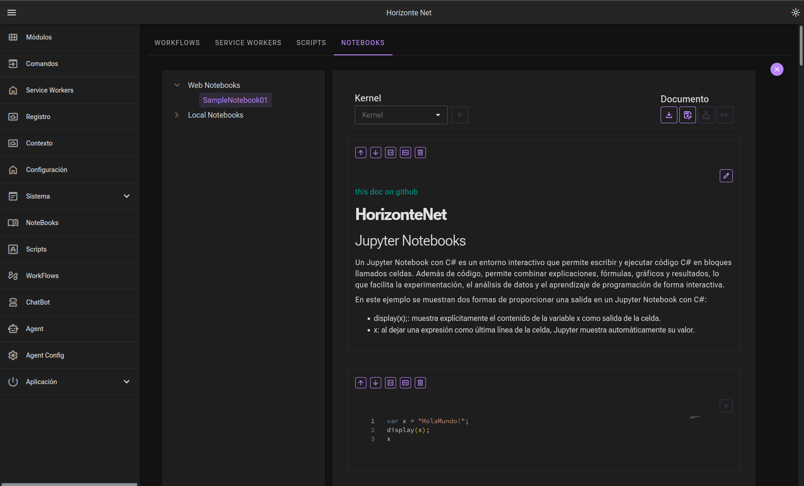
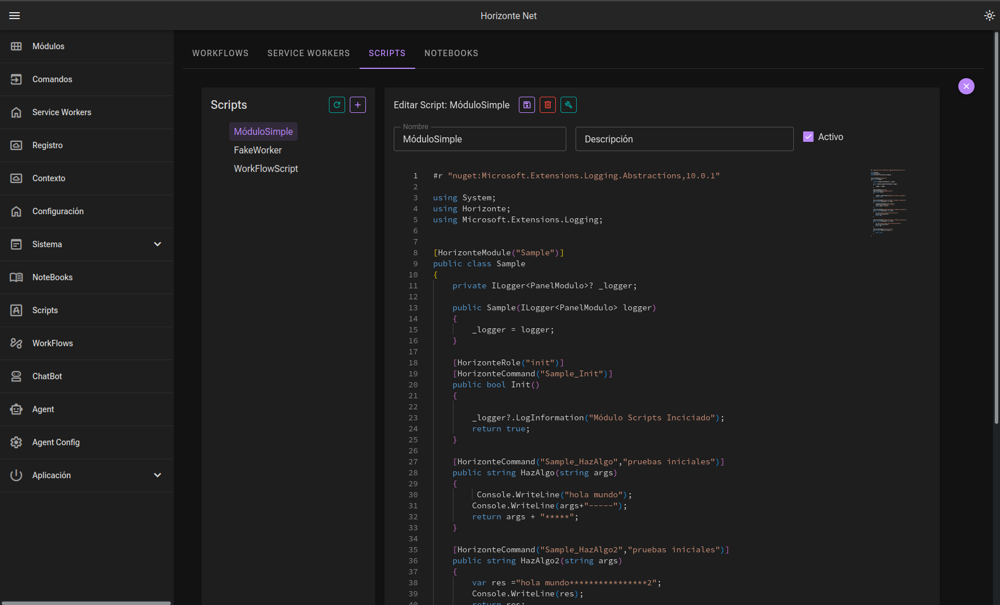
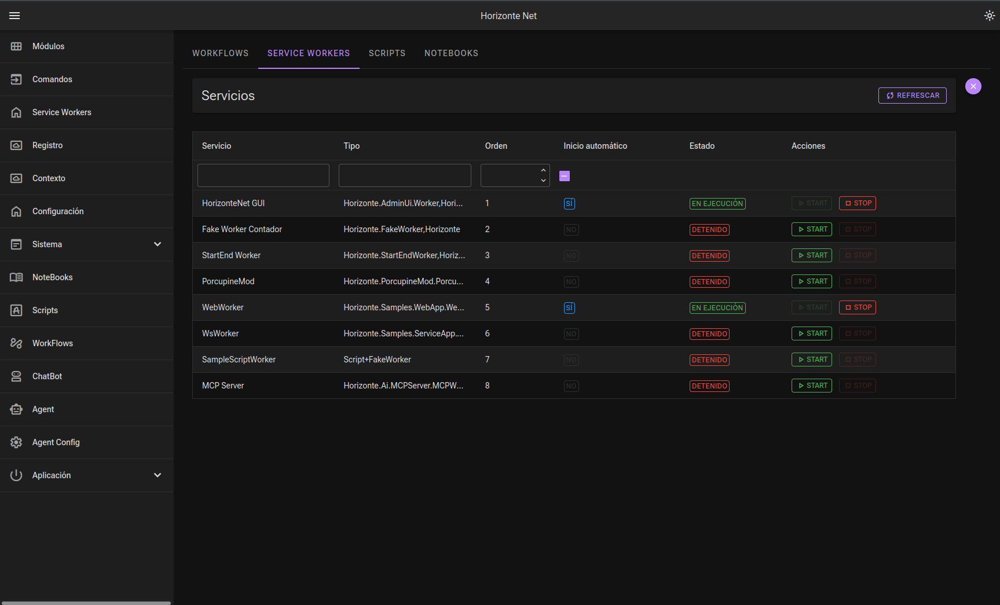
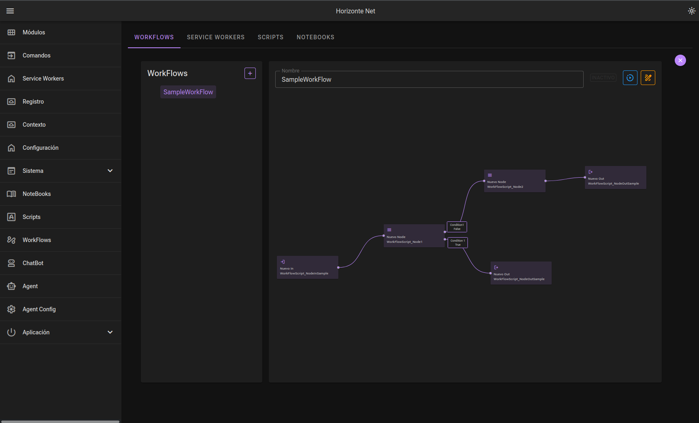

# HorizonteNet 

**HorizonteNet** es un entorno modular avanzado desarrollado sobre **.NET 10**, diseñado para facilitar la creación de aplicaciones extensibles y distribuidas mediante paquetes NuGet.

---

## Arquitectura modular

HorizonteNet se basa en una arquitectura de microservicios y módulos desacoplados:

- **Core (`Horizonte`)**  
  Núcleo del sistema encargado de gestionar el contexto (`IhContext`) y el ciclo de vida de los trabajadores (`HWorkersManager`).

- **Admin UI (`Horizonte.AdminUi`)**  
  Interfaz de administración moderna y reactiva construida con **Blazor**.

- **Extensiones del Core (`Horizonte.Extension`)**  
  Ecosistema de extensiones para trabajar con scripts en C#, notebooks, flujos de trabajo y agentes de IA.

- **Módulos (`Horizonte.Modules`)**  
  Conjunto de módulos que amplían la funcionalidad de HorizonteNet con capacidades predefinidas y personalizables:

  - **Admin UI:** panel de administración para gestionar extensiones y módulos.
  - **Scripts:** ejecución y gestión de scripts en C# y Jupyter Notebooks.
  - **Workflows:** orquestación de flujos de trabajo personalizables.
  - **Agents:** definición y ejecución de agentes autónomos.
  - **MCP Server:** servicio basado en Model Context Protocol que integra las funcionalidades de los módulos.

---

## Características principales

- **Gestión flexible del contexto:** sistema de configuración basado en JSON, con soporte para sobrescrituras locales y de usuario.
- **Servicios en segundo plano:** orquestación simplificada de servicios, trabajadores y tareas programadas.
- **Administración de ensamblados:** gestión de paquetes NuGet, código no administrado y contenidos web asociados.
- **Extensibilidad:** diseñado para ampliarse mediante nuevas extensiones, módulos y workflows.
- **Multiplataforma:** compatible con Linux, Windows y macOS.

---

## Vista previa 10.0.1-beta

Es posible ejecutar HorizonteNet directamente desde los binarios compilados disponibles en la release del proyecto:

- [Ejecutable para Windows](http://)
- [Ejecutable para Linux](http://)

### Ejecución desde binarios

1. Descarga el ejecutable correspondiente a tu sistema operativo.
2. Ejecuta el archivo descargado.
3. Abre la aplicación en el navegador:

   ```text
   http://localhost:5000
   ```

---

## Empezando

### Requisitos previos

- [.NET 10 SDK](https://dotnet.microsoft.com/download) o superior.
- Un entorno de desarrollo compatible:
  - JetBrains Rider
  - Visual Studio
  - Visual Studio Code

### Instalación desde el código fuente

1. Clona el repositorio:

   ```bash
   git clone https://github.com/franfusto/HorizonteNet.git
   ```

2. Accede al directorio del proyecto:

   ```bash
   cd HorizonteNet
   ```

3. Restaura las dependencias:

   ```bash
   dotnet restore
   ```

4. Compila el proyecto:

   ```bash
   dotnet build
   ```

5. Ejecuta el proyecto `ConsoleApp`:

   ```bash
   dotnet run --project Launchers/ConsoleApp
   ```

6. Abre la aplicación en el navegador:

   ```text
   http://localhost:5000
   ```

---

## Explora

Puedes descargar un archivo de contexto de ejemplo para explorar la configuración y estructura inicial de HorizonteNet:

- [Descargar contexto de ejemplo](githubfiles/horizonte_sample.json)

Este archivo puede utilizarse como punto de partida para revisar cómo se define un contexto, cómo se organizan los módulos y cómo se configuran las extensiones dentro del entorno.

Integración con Jupyter Notebooks


Sistema scripting embedido


Orqestación de servicios


WorkFlows con Microsoft.Agents.AI.Workflows



---

## Estado del proyecto

HorizonteNet se encuentra actualmente en fase **Beta**.

El proyecto está en desarrollo activo, por lo que cualquier feedback, reporte de errores o propuesta de mejora es bienvenido.

Puedes participar a través de:

- [GitHub Issues](https://github.com/franfusto/HorizonteNet/issues)
- [Discord](https://discord.com/channels/1538980325953249290/1538980326527995960)

---

## Información del proyecto

- **Repositorio:** [github.com/franfusto/HorizonteNet](https://github.com/franfusto/HorizonteNet)
- **Autor:** franfusto
- **Licencia:** [MIT](LICENSE)

---

*HorizonteNet — elevando el desarrollo modular en .NET.*
