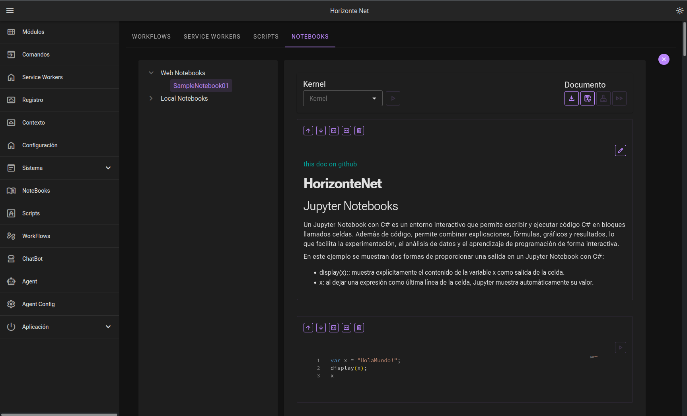
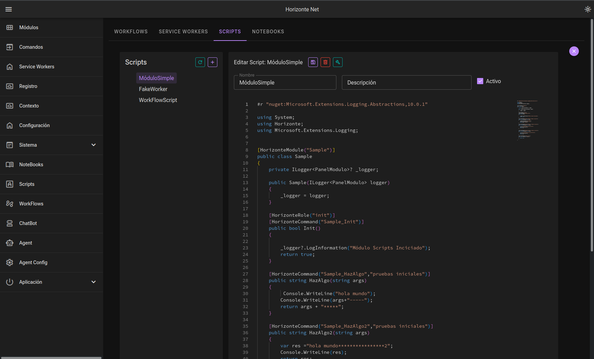
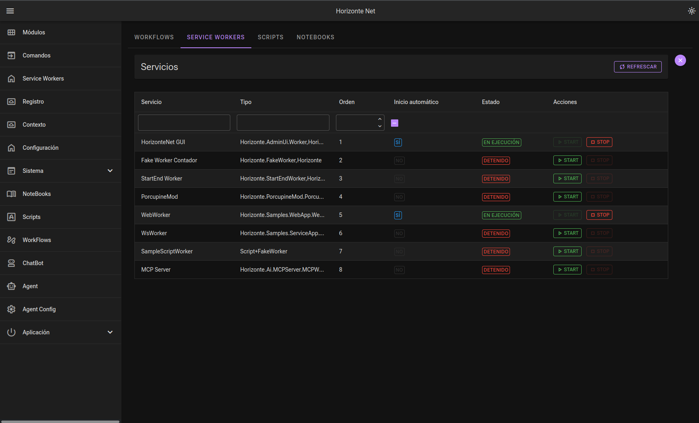
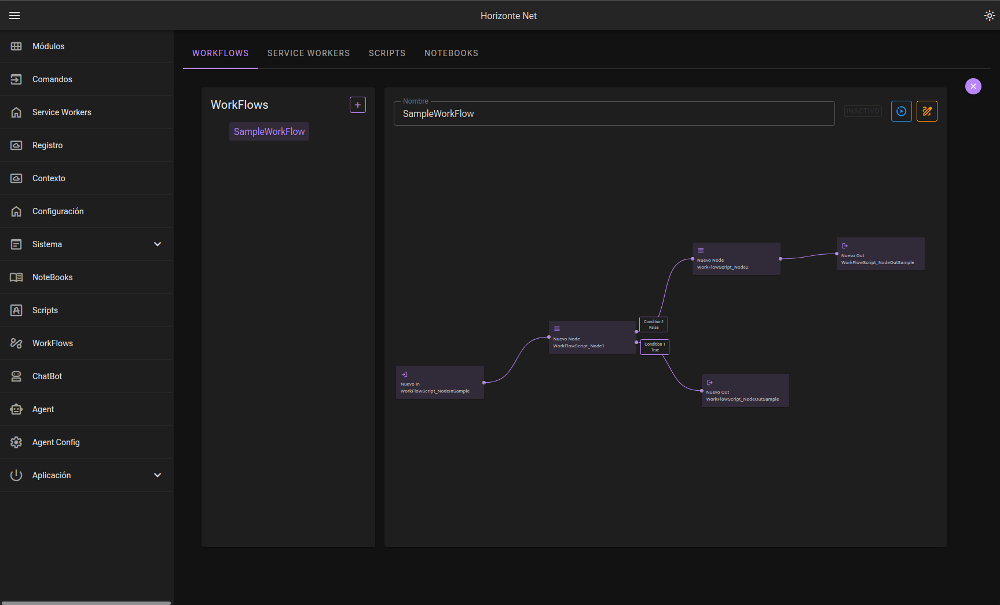

# HorizonteNet 
[Español](README_es.md) | [English](README.md)

---

**HorizonteNet** es un entorno modular avanzado desarrollado sobre **.NET 10**, diseñado para facilitar la creación de aplicaciones extensibles y distribuidas mediante paquetes NuGet.

---

## Arquitectura modular

HorizonteNet se basa en una arquitectura de microservicios y módulos desacoplados:

- **Core (`Horizonte`)**  
  Núcleo del sistema encargado de gestionar el contexto (`IhContext`) y el ciclo de vida de los trabajadores (`HWorkersManager`).

- **Admin UI (`Horizonte.AdminUi`)**  
  Interfaz de administración moderna y reactiva construida con **Blazor**.

- **Extensiones del Core (`Horizonte.Extension`)**  
  Ecosistema de extensiones para trabajar con scripts en C#, notebooks, flujos de trabajo y agentes de IA.

- **Módulos (`Horizonte.Modules`)**  
  Conjunto de módulos que amplían la funcionalidad de HorizonteNet con capacidades predefinidas y personalizables:

  - **Admin UI:** panel de administración para gestionar extensiones y módulos.
  - **Scripts:** ejecución y gestión de scripts en C# y Jupyter Notebooks.
  - **Workflows:** orquestación de flujos de trabajo personalizables.
  - **MCP Server:** servicio basado en Model Context Protocol que integra las funcionalidades de los módulos.
  

---

## Características principales

- **Gestión flexible de la arquitectura modular:** sistema de configuración basado en JSON, con soporte para sobrescrituras locales y de usuario.
- **Carga de módulos en ALC:** Aislamiento de módulos en diferentes dominios de aplicación (AppDomains).
- **Hot Reload** soportado para cambios en los servicios, módulos y scripts.
- **Servicios en segundo plano:** orquestación simplificada de servicios, trabajadores y tareas programadas.
- **Administración de ensamblados:** gestión de paquetes NuGet, código no administrado y contenidos web asociados.
- **Extensibilidad:** diseñado para ampliarse mediante nuevas extensiones, módulos y workflows.
- **Multiplataforma:** compatible con Linux, Windows y macOS.

---

## Documentación técnica

Cada componente del ecosistema HorizonteNet cuenta con especificaciones de arquitectura detalladas:

- **Núcleo de HorizonteNet (`Horizonte`)**:  
  Arquitectura del orquestador central (`IEnvCoordinator`), ciclo de vida de dominios en ALC coleccionables, resolución y caché NuGet (`IHAssemblyCache`), andamiaje de enlaces simbólicos y despacho de comandos desacoplados.  
  📖 [Especificación de arquitectura](Horizonte/ARQUITECTURA_ES.md)

- **Extensiones Interactivas (`Horizonte.Extensions.Interactive`)**:  
  Integración con .NET Interactive y compilación dinámica en memoria mediante Roslyn (`CSharpCompilation`), intercepción de directivas `#r` y despliegue automático en dominios aislados.  
  📖 [Especificación de arquitectura](Horizonte.Extensions.Interactive/ARQUITECTURA_ES.md)

- **Soporte Web y Middleware (`Horizonte.Extension.AspNetCore`)**:  
  Middleware de entrega de archivos estáticos y recursos web empaquetados (`_content/...`) con resolución contextual por dominio y streaming optimizado con `IHttpResponseBodyFeature`.  
  📖 [Especificación de arquitectura](Horizonte.Extension.AspNetCore/ARQUITECTURA_ES.md)

- **Flujos de Trabajo Inteligentes (`Horizonte.Extension.AiWorkFlows`)**:  
  Orquestación de grafos dirigidos con `Microsoft.Agents.AI.Workflows`, puntos de control (checkpoints), pausa/reanudación, agentes de IA e indexación semántica vectorial de comandos con OpenAI y Semantic Kernel.  
  📖 [Especificación de arquitectura](Horizonte.Extension.AiWorkFlows/ARQUITECTURA_ES.md)


---

## Vista previa 10.0.7-beta

Es posible ejecutar HorizonteNet directamente desde los binarios compilados disponibles en la release del proyecto:

- [Ejecutable para Windows](https://github.com/franfusto/HorizonteNet/releases/download/10.0.7-beta/ConsoleApp.exe)
- [Ejecutable para Linux](https://github.com/franfusto/HorizonteNet/releases/download/10.0.7-beta/ConsoleApp)

### Ejecución desde binarios

1. Descarga el ejecutable correspondiente a tu sistema operativo.
2. Ejecuta el archivo descargado.
3. Abre la aplicación en el navegador:

   ```text
   http://localhost:5000
   ```

---

## Empezando

### Requisitos previos

- [.NET 10 SDK](https://dotnet.microsoft.com/download) o superior.
- Un entorno de desarrollo compatible:
  - JetBrains Rider
  - Visual Studio
  - Visual Studio Code

### Instalación desde el código fuente

1. Clona el repositorio:

   ```bash
   git clone https://github.com/franfusto/HorizonteNet.git
   ```

2. Accede al directorio del proyecto:

   ```bash
   cd HorizonteNet
   ```

3. Restaura las dependencias:

   ```bash
   dotnet restore
   ```

4. Compila el proyecto:

   ```bash
   dotnet build
   ```

5. Ejecuta el proyecto `ConsoleApp`:

   ```bash
   dotnet run --project Launchers/ConsoleApp
   ```

6. Abre la aplicación en el navegador:

   ```text
   http://localhost:5000
   ```

---

## Explora

Puedes descargar un archivo de contexto de ejemplo para explorar la configuración y estructura inicial de HorizonteNet:

- [Descargar contexto de ejemplo](githubfiles/horizonte_sample.json)

Este archivo puede utilizarse como punto de partida para revisar cómo se define un contexto, cómo se organizan los módulos y cómo se configuran las extensiones dentro del entorno.

<table>
  <tr>
    <td align="center">
      <strong>Integración con Jupyter Notebooks</strong><br>
      
    </td>
    <td align="center">
      <strong>Sistema scripting embedido</strong><br>
      
    </td>
  </tr>
  <tr>
    <td align="center">
      <strong>Orquestación de servicios</strong><br>
      
    </td>
    <td align="center">
      <strong>WorkFlows con Microsoft.Agents.AI.Workflows</strong><br>
      
    </td>
  </tr>
</table>


---

## Docker

HorizonteNet está disponible como imagen Docker publicada en [Docker Hub](https://hub.docker.com/r/franfusto/horizontenet/tags).

### Ejecución con Docker CLI

Puedes iniciar un contenedor directamente con el siguiente comando:

```bash
docker run -d \
  --name app_horizonte \
  -p 5000:5000 \
  -e PUID=1000 \
  -e PGID=1000 \
  -v ./horizonte:/home/horizonte \
  --restart unless-stopped \
  franfusto/horizontenet:10.0.7-beta
```

### Ejecución con Docker Compose

Crea un archivo `docker-compose.yml` con la siguiente configuración:

```yaml
services:
  app:
    image: franfusto/horizontenet:10.0.7-beta
    container_name: app_horizonte
    ports:
      - "5000:5000"
    environment:
      - PUID=${PUID:-1000}
      - PGID=${PGID:-1000}
    volumes:
      - ./horizonte:/home/horizonte
    restart: unless-stopped
```

Inicia el servicio ejecutando:

```bash
docker compose up -d
```

Abre la aplicación en el navegador:

```text
http://localhost:5000
```

---

## Estado del proyecto

HorizonteNet se encuentra actualmente en fase **Beta**.

El proyecto está en desarrollo activo, por lo que cualquier feedback, reporte de errores o propuesta de mejora es bienvenido.

Puedes participar a través de:

- [GitHub Issues](https://github.com/franfusto/HorizonteNet/issues)
- [Discord](https://discord.com/channels/1538980325953249290/1538980326527995960)

---

## Información del proyecto

- **Repositorio:** [github.com/franfusto/HorizonteNet](https://github.com/franfusto/HorizonteNet)
- **Autor:** franfusto
- **Licencia:** [MIT](LICENSE)

---

*HorizonteNet — elevando el desarrollo modular en .NET.*
